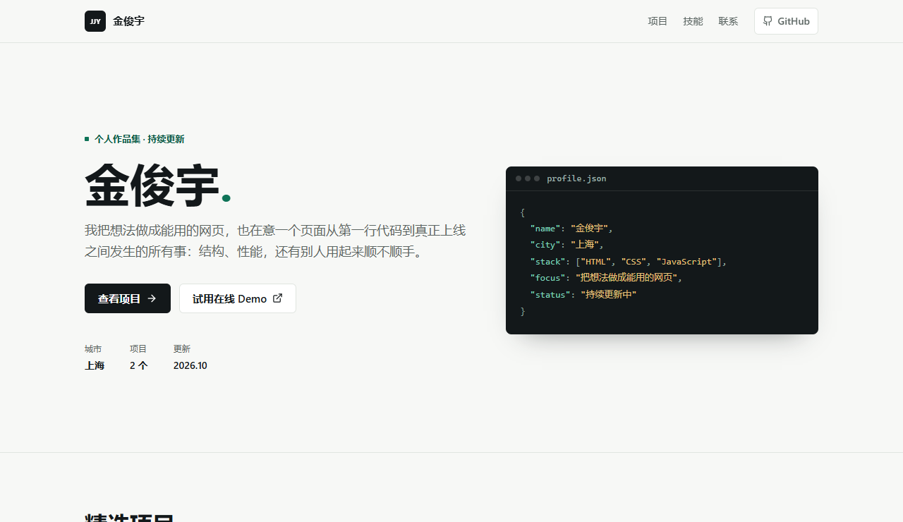

# 金俊宇 · 个人作品集

一个零依赖、零构建的静态站点，包含个人介绍页和一个可直接使用的任务清单小应用。

- 线上地址：https://milky-rivers.github.io/my-portfolio/
- 源码地址：https://github.com/Milky-Rivers/my-portfolio
- 技术栈：HTML / CSS / 原生 JavaScript，部署在 GitHub Pages



## 包含什么

- **作品集首页**：个人介绍、两个项目入口、技能清单、联系方式。
- **任务清单 Demo**：可添加、勾选、筛选、删除任务，数据存在浏览器本地，刷新不丢。

## 目录结构

```
index.html     作品集首页
demo.html      任务清单 Demo
styles.css     全站样式（含响应式断点）
main.js        首页小交互（年份、复制邮箱）
demo.js        任务清单逻辑
assets/        图标与截图
```

## 本地预览

直接双击 `index.html` 就能看。也可以起一个本地服务，避免部分浏览器对 `file://` 的限制：

```powershell
npx serve .
# 打开终端里提示的地址，默认 http://localhost:3000
```

装了 Python 的话也可以用 `python -m http.server 8000`。

## 实现要点

- 布局用 Grid 和 Flex 手写，断点在 900px / 720px / 640px，无 UI 框架。
- 任务清单用「改状态 -> 重绘」的单一数据流，事件监听挂在列表父级做事件委托。
- 用户输入统一用 `textContent` 写入，不拼 HTML 字符串，避免 XSS。
- 数据存 `localStorage` 并做了读写异常兜底，隐私模式下页面仍可使用。
- 筛选按钮用 `aria-pressed` 表达状态，复选框带可读标签，键盘可以完整操作。

## 更新与部署

```bash
git add .
git commit -m "feat: 这次改了什么"
git push
```

仓库走 GitHub Pages 的 `Deploy from a branch`（`main` 分支、根目录），推到 `main` 后会**自动重新构建**，大约 1 分钟生效，不需要手动点任何按钮。

## 一些说明

- 页面不加载任何外部字体、统计脚本或 UI 框架，打开就是一个 HTML 文件和一份 CSS。
- 任务数据只存在当前浏览器的 `localStorage` 里，换设备或清缓存会丢，这是这个 Demo 的已知边界。
- 首屏和项目区都在 1280px 与 390px 宽度下做过检查，没有横向溢出。
